# Group 2 - ML Element 1 Documentation Report

**Project:** Two Rwandan Scenarios: Build Machine-Learning-Ready Datasets  
**Group:** Group 2  
**Members:** Armand Ikirezi and Mariam Nyirarukundo  
**Institution:** Kigali College, Rwanda Polytechnic  
**Date:** 12 November 2026  

## 1. Purpose and Scope

This report documents the preparation of two datasets for later machine-learning work. The project stops at dataset preparation: no prediction model is trained here.

- **Question 1:** maize yield data preparation for Rwanda.
- **Question 2:** synthetic road traffic accident severity data preparation for Rwanda.

The report records the environment, data acquisition, quality checks, cleaning decisions, feature engineering, final outputs, limitations, and reproducibility evidence. The screenshots in `screenshots/` are the evidence captured from the notebooks and project environment.

## 2. Environment and Repository

The project uses Anaconda and Jupyter Notebook with Python 3.11. The main libraries are pandas, NumPy, Matplotlib, Seaborn, scikit-learn, joblib, and Jupyter. Pandas and NumPy support tabular data preparation; Matplotlib and Seaborn support visual EDA; scikit-learn provides preprocessing, splitting, encoding, scaling, and feature selection; joblib stores reusable pipelines.

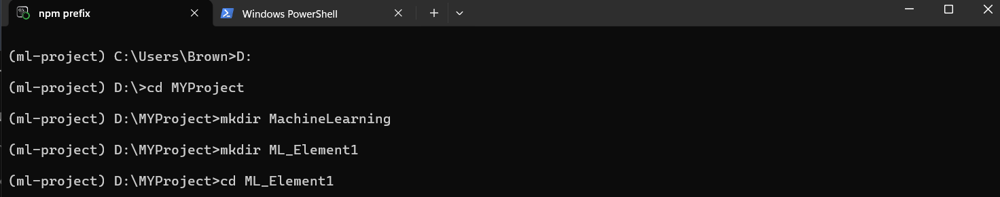

*Figure 1: The project conda environment is configured for the work.*

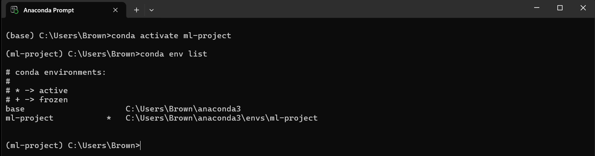

*Figure 2: The environment list shows the project environment used for the notebooks.*

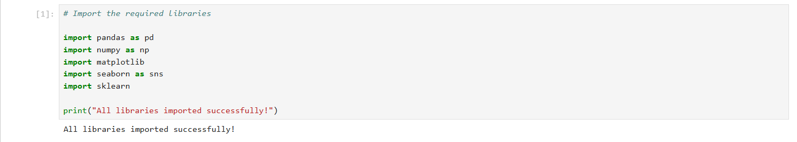

*Figure 3: Required Python libraries and their versions were checked in the notebook.*

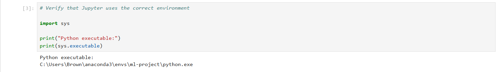

*Figure 4: The selected Python interpreter is the project environment interpreter.*

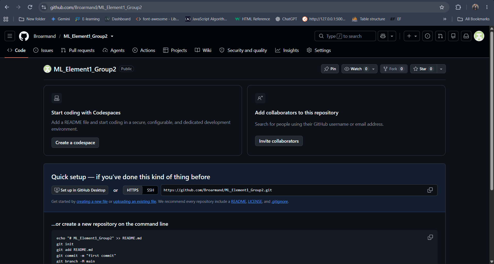

*Figure 5: The project repository provides version control for the notebooks, data, and documentation.*

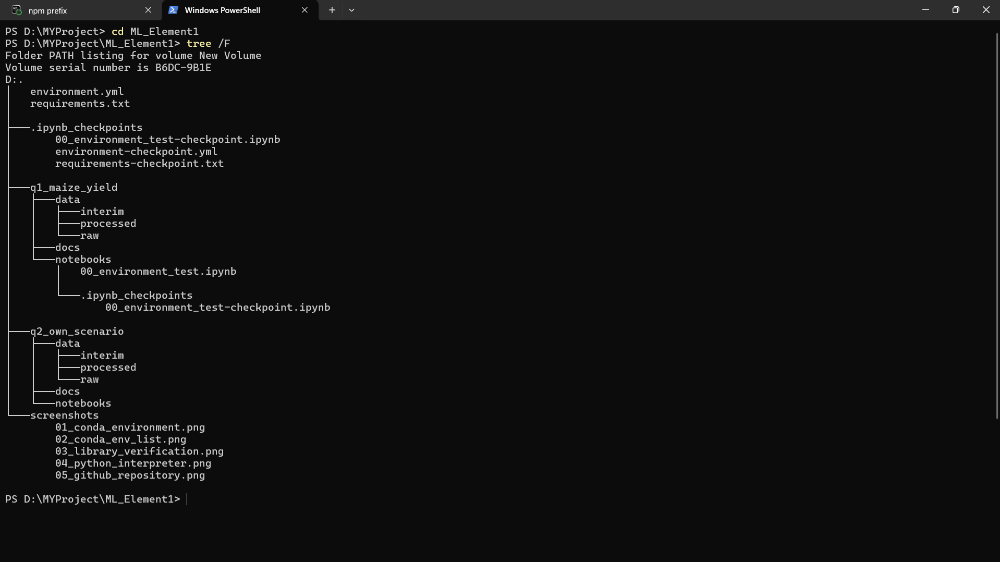

*Figure 6: The repository contains separate Q1 and Q2 data, notebook, documentation, and processed-data folders.*

## 3. Question 1: Maize Yield Dataset

### 3.1 Scenario and data requirements

The supplied Q1 data is intended to support later analysis of maize yield per hectare in Rwanda. The target in the supplied CSV is `yield_t_ha`. Relevant predictors include location, year, season, altitude, weather, soil, seed variety, farming practice, fertiliser, irrigation, pest incidence, plant density, and farm area.

The raw file was kept unchanged in `q1_maize_yield/data/raw/maize_yield_rwanda_rw.csv`. The acquisition documentation records that the file is a course-supplied synthetic dataset and that its actual schema differs from the illustrative schema in the task brief. In particular, the supplied file uses `record_id` and `yield_t_ha`, and contains fertiliser rates such as `npk_kg_ha`, `urea_kg_ha`, and `manure_t_ha`. This difference is documented as a limitation and should be confirmed with the course provider before operational use.

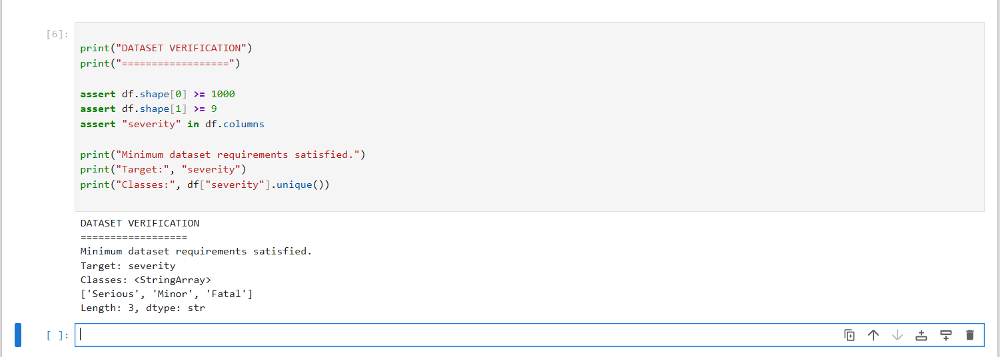

*Figure 7: The acquisition stage loads the supplied Q1 file and checks its contents.*

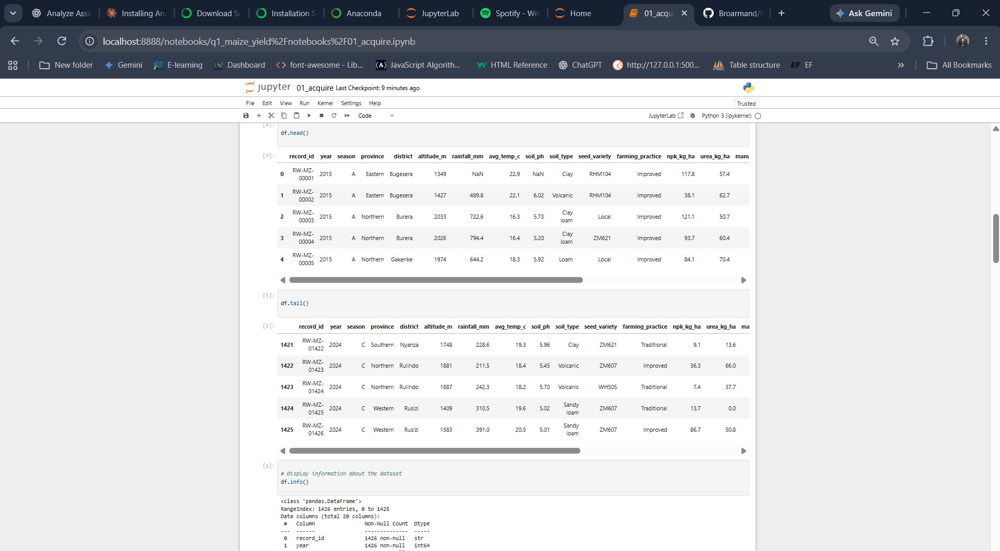

*Figure 8: The first records, dimensions, and data types are inspected before cleaning.*

*Figure 9: The Q1 data dictionary describes the available fields, types, units, and notes.*

*Figure 10: The source log records the supplied synthetic dataset, its limitations, and ethical considerations.*

### 3.2 Quality assessment

The raw Q1 dataset contains **1,426 rows and 20 columns**. The audit found **39 missing values** and no exact duplicate rows or duplicate `record_id` values.

| Finding | Affected column(s) | Records | Treatment |
|---|---|---:|---|
| Missing values | `rainfall_mm` | 11 | Median imputation during preprocessing |
| Missing values | `soil_ph` | 14 | Median imputation during preprocessing |
| Missing values | `pest_incidence_index` | 14 | Median imputation during preprocessing |
| Exact duplicate rows | All columns | 0 | No removal required |
| Duplicate identifiers | `record_id` | 0 | No removal required |
| Potential IQR outliers | `soil_ph` | 10 | Investigated and retained because an IQR flag is not automatically an error |
| Potential IQR outliers | `manure_t_ha` | 6 | Investigated and retained |
| Potential IQR outliers | `farm_area_ha` | 75 | Investigated and retained |
| Potential IQR outliers | `pest_incidence_index` | 13 | Investigated and retained |
| Potential IQR outliers | `yield_t_ha` | 8 | Investigated and retained pending domain confirmation |

No invalid domain values were identified in the audit. Categorical values, distributions, missingness, duplicates, and correlations were checked before transformation.

*Figure 11: The Q1 structure and missing-value checks establish the raw data types and completeness.*

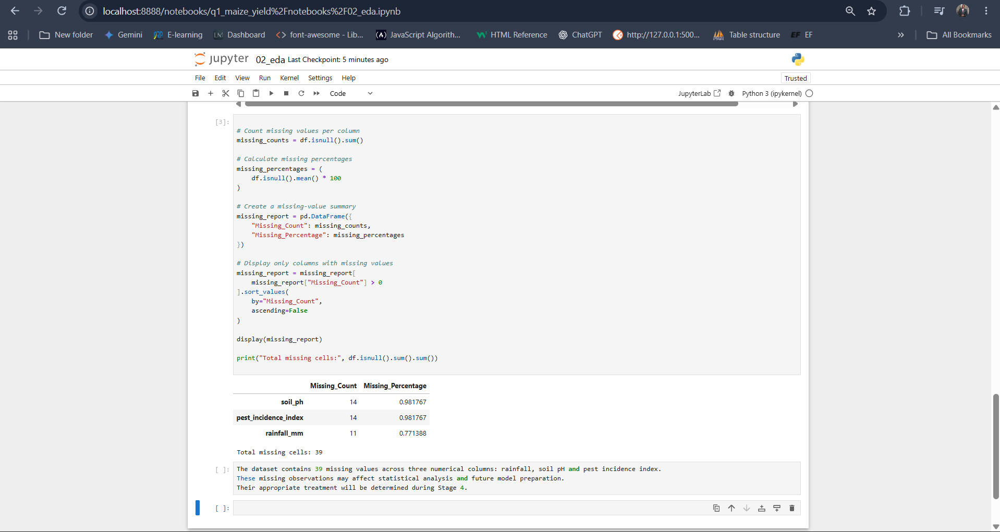

*Figure 12: Missing values are concentrated in rainfall, soil pH, and pest incidence.*

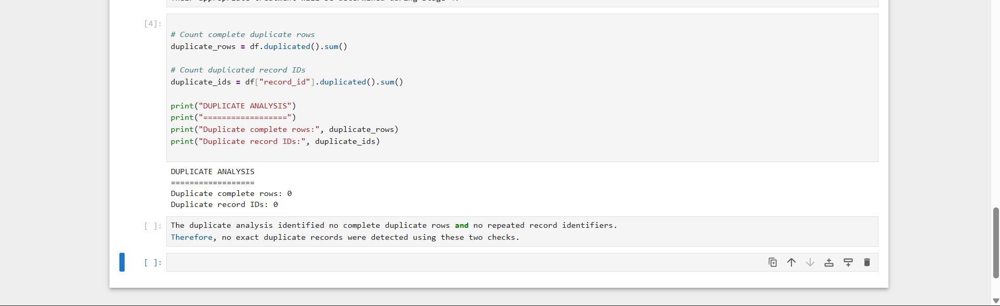

*Figure 13: Duplicate analysis confirms that no repeated Q1 records require removal.*

*Figure 14: The missing-value detail view supports the counts recorded in the quality report.*

*Figure 15: The duplicate result output shows the duplicate check outcome.*

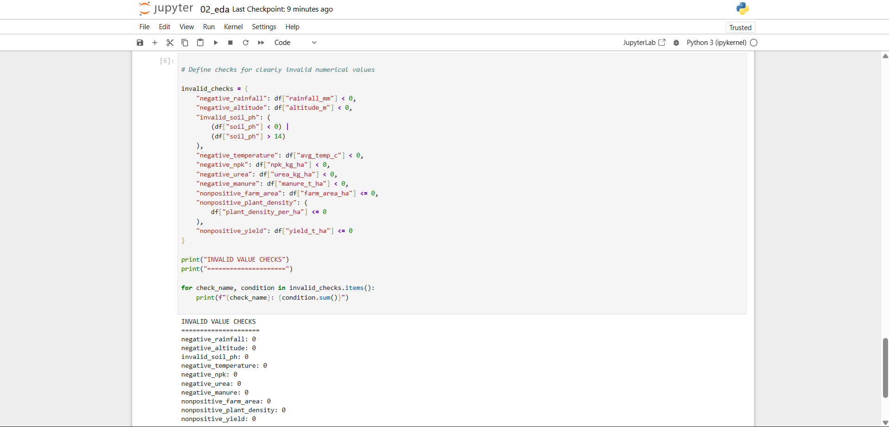

*Figure 16: Numeric and domain checks were used to identify values requiring investigation.*

*Figure 17: Category inspection checks spelling and consistency before encoding.*

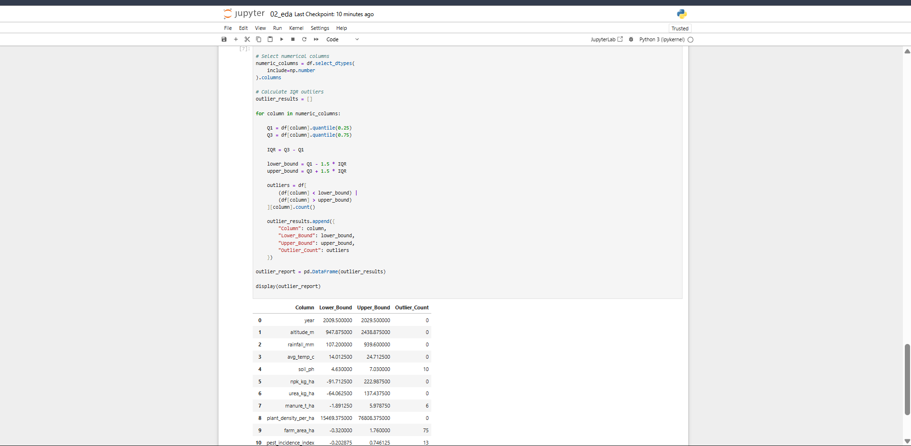

*Figure 18: IQR analysis identifies statistical outliers for review rather than automatically deleting them.*

*Figure 19: The outlier output records the columns and observations requiring domain review.*

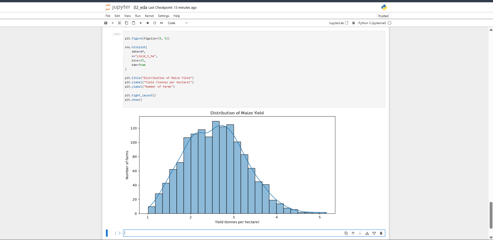

*Figure 20: The target distribution is inspected before the target is separated from the predictors.*

*Figure 21: The EDA charts examine relationships among location, farming conditions, inputs, and yield.*

*Figure 22: Correlation analysis supports the decisions about useful numeric variables and engineered features.*

### 3.3 Cleaning and preprocessing

The Q1 cleaning process retained all 1,426 rows. Missing numeric values were imputed with training-derived medians and missing categorical values with the most frequent training category. This prevents missing values from reaching a later model while avoiding estimates based on validation or test data.

`record_id` was excluded from predictors because it is an identifier rather than a meaningful measurement. `yield_t_ha` was separated as the target. Categorical predictors were encoded, numerical predictors were scaled, and the data was split with a fixed seed:

- Training: 998 rows
- Validation: 214 rows
- Test: 214 rows

The cleaning log records zero exact duplicate removals and zero rows removed for missing targets. The preprocessing pipeline is stored in `q1_maize_yield/data/interim/maize_preprocessing_pipeline.joblib`.

### 3.4 Feature engineering and selection

Six engineered features were created:

1. `total_mineral_fertilizer_kg_ha` = NPK plus urea application.
2. `manure_kg_ha` = manure tonnes per hectare converted to kilograms per hectare.
3. `estimated_total_plants` = plant density multiplied by farm area.
4. `rainfall_temperature_interaction` = rainfall multiplied by average temperature.
5. `soil_ph_distance_from_neutral` = absolute distance of soil pH from 7.
6. `npk_fertilizer_share` = NPK divided by total mineral fertiliser.

Feature analysis and selection produced the following final predictor set: `rainfall_mm`, `npk_kg_ha`, `urea_kg_ha`, `plant_density_per_ha`, `pest_incidence_index`, `total_mineral_fertilizer_kg_ha`, `rainfall_temperature_interaction`, `season_A`, `season_C`, `soil_type_Volcanic`, `seed_variety_Local`, `seed_variety_PAN691`, `seed_variety_RHM104`, `farming_practice_Improved`, and `farming_practice_Traditional`.

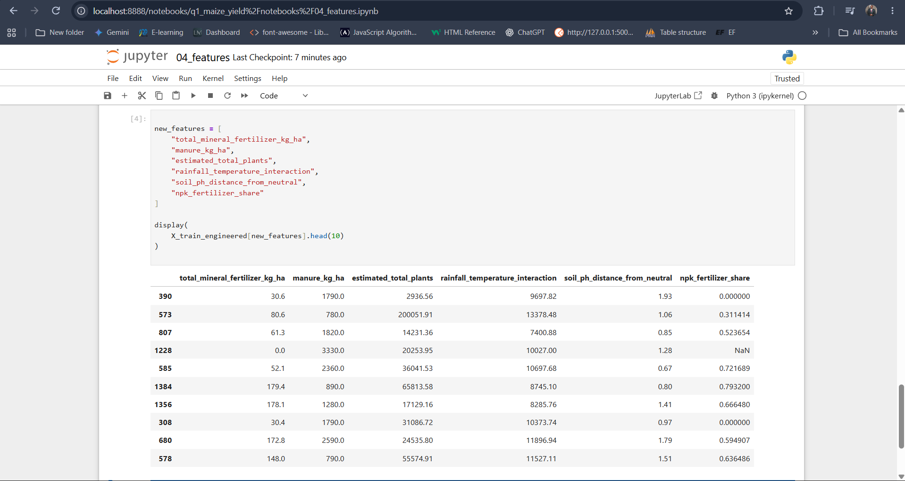

*Figure 23: The Q1 notebook displays the newly engineered features.*

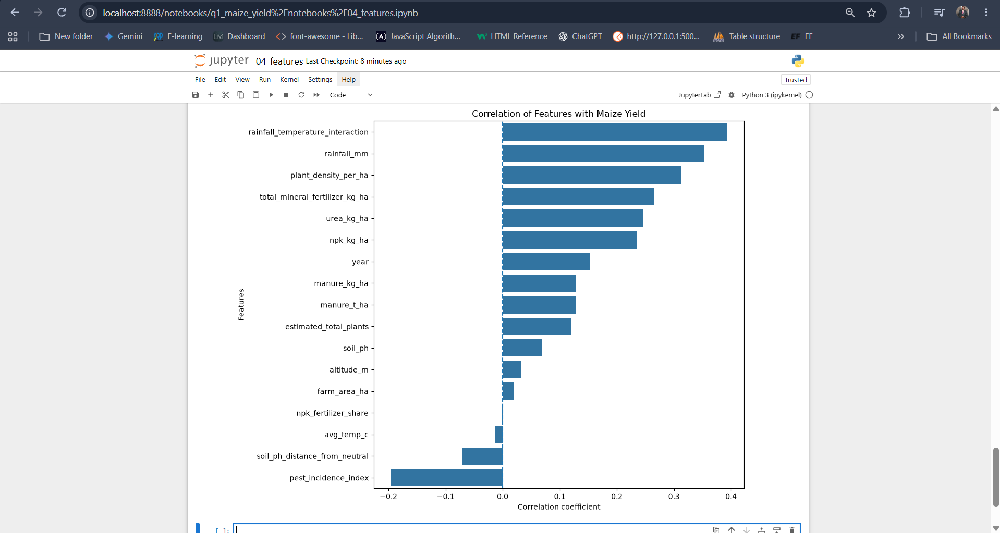

*Figure 24: Feature correlation and relationship analysis informs feature selection.*

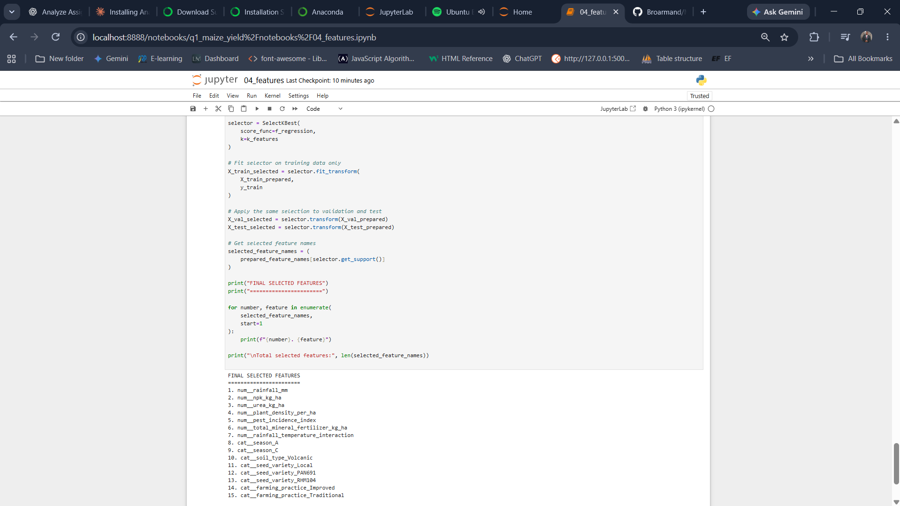

*Figure 25: The final selected Q1 features are displayed before saving the processed datasets.*

### 3.5 Q1 final outputs

The final Q1 files are saved in `q1_maize_yield/data/processed/`:

- `maize_yield_train_final.csv`
- `maize_yield_validation_final.csv`
- `maize_yield_test_final.csv`

Each file contains 15 predictors and the target `yield_t_ha`, for 16 columns in total. Supporting tables are available in `q1_maize_yield/docs/`, including the data dictionary, source log, data quality report, cleaning log, and feature justification table.

## 4. Question 2: Road Traffic Accident Severity

### 4.1 Scenario proposal

The Q2 scenario is classification of simulated road traffic accident severity for the Rwanda Road Safety and Traffic Management Unit. The location context is Rwanda, with district labels represented in the synthetic data. The target is `severity` with three classes: `Minor`, `Serious`, and `Fatal`.

The scenario is educational and does not claim to represent official police or road safety statistics. It is designed to prepare data for a future classification model that could examine relationships among road type, weather, surface, lighting, time, vehicle type, speed limits, affected users, and emergency response time.

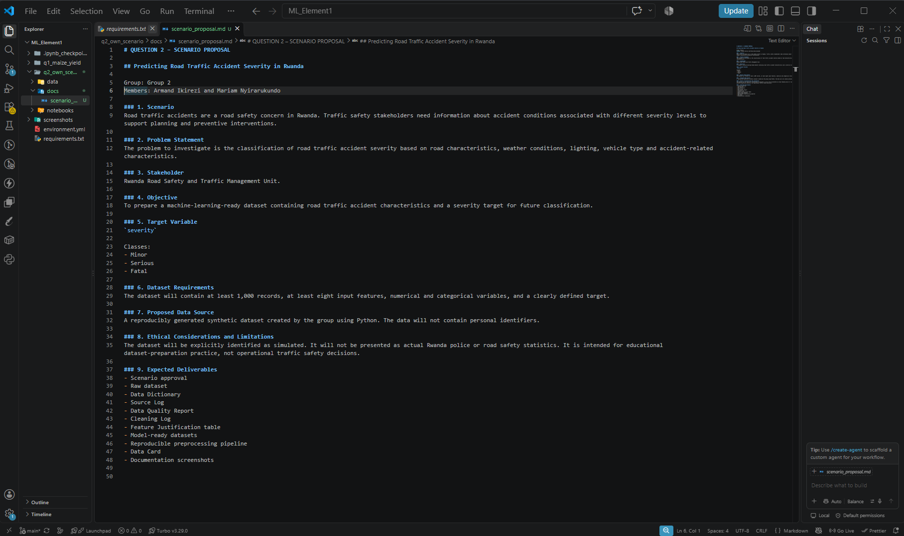

*Figure 26: The Q2 scenario proposal defines the stakeholder, target, problem type, source, and risks. The required approval signature should be added before submission.*

### 4.2 Acquisition and data dictionary

The Q2 raw file is a reproducibly generated synthetic dataset. It contains **1,608 records and 13 columns** before cleaning. It includes both numerical and categorical predictors and contains no personal identifiers. The source log identifies the dataset as group-generated synthetic data and records the intended educational use.

The raw file was kept unchanged in `q2_own_scenario/data/raw/rwanda_traffic_accidents_synthetic.csv`.

*Figure 27: The Q2 acquisition stage loads the synthetic traffic dataset.*

*Figure 28: The Q2 dataset is inspected for dimensions, columns, and initial data types.*

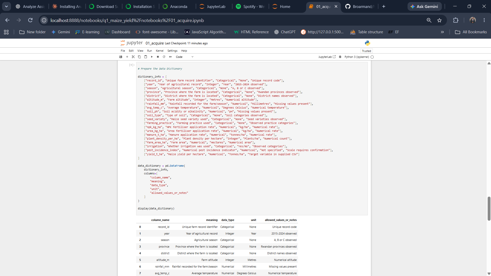

*Figure 29: The Q2 data dictionary defines each accident field and its allowed values or notes.*

*Figure 30: The Q2 source log identifies the generator, licence proposal, limitations, and ethical position.*

### 4.3 Quality assessment

The Q2 audit found **97 missing values**:

- `weather`: 41 records, 2.55 percent
- `road_surface`: 32 records, 1.99 percent
- `response_time_min`: 24 records, 1.49 percent

There were **8 exact duplicate rows and 8 duplicate `accident_id` values**. These were removed because they represented repeated accident records. IQR analysis identified possible outliers in `speed_limit_kmh` (84), `vehicles_involved` (115), and `response_time_min` (48). The observations were reviewed and not automatically removed because statistical outlier status alone does not prove that a value is incorrect.

*Figure 31: Missing-value analysis identifies the Q2 fields requiring imputation.*

*Figure 32: Duplicate analysis identifies the eight repeated accident records removed during cleaning.*

*Figure 33: Category checks review weather, road surface, lighting, road type, and vehicle labels.*

*Figure 34: IQR analysis identifies possible numeric outliers for review.*

*Figure 35: The EDA charts investigate the distribution of accident conditions and severity.*

*Figure 36: Relationship analysis supports the choice of candidate predictors and engineered indicators.*

### 4.4 Cleaning and preprocessing

The Q2 cleaning process removed exactly eight duplicate records, reducing the dataset from 1,608 to 1,600 rows. Missing categorical values were imputed with the most frequent training category and missing `response_time_min` values were imputed with a training-derived numeric statistic. The cleaning and preprocessing steps were applied consistently to the training, validation, and test partitions.

`accident_id` was excluded from the predictors because it is an identifier. `severity` was separated as the target. The split sizes were:

- Training: 1,120 rows
- Validation: 240 rows
- Test: 240 rows

The preprocessed split files contain 41 encoded/scaled predictor columns and the target, for 42 columns in the full preprocessed representation. The selected-feature files contain 10 predictors and `severity`, for 11 columns.

### 4.5 Feature engineering and selection

Six Q2 features were engineered:

1. `night_accident` indicates nighttime accidents.
2. `poor_weather` indicates rain or fog.
3. `poor_surface` indicates wet or damaged road surface.
4. `high_risk_vehicle` indicates bus or truck involvement.
5. `multi_vehicle` indicates two or more vehicles.
6. `affected_users_group` groups the number of affected road users into low, medium, and high categories.

Mutual-information analysis was used for feature selection. The final selected predictors were `speed_limit_kmh`, `poor_weather`, `poor_surface`, `high_risk_vehicle`, `weather_Clear`, `weather_Fog`, `weather_Rain`, `road_surface_Dry`, `lighting_Dark`, and `lighting_Daylight`.

*Figure 37: The Q2 notebook displays the engineered accident-risk features.*

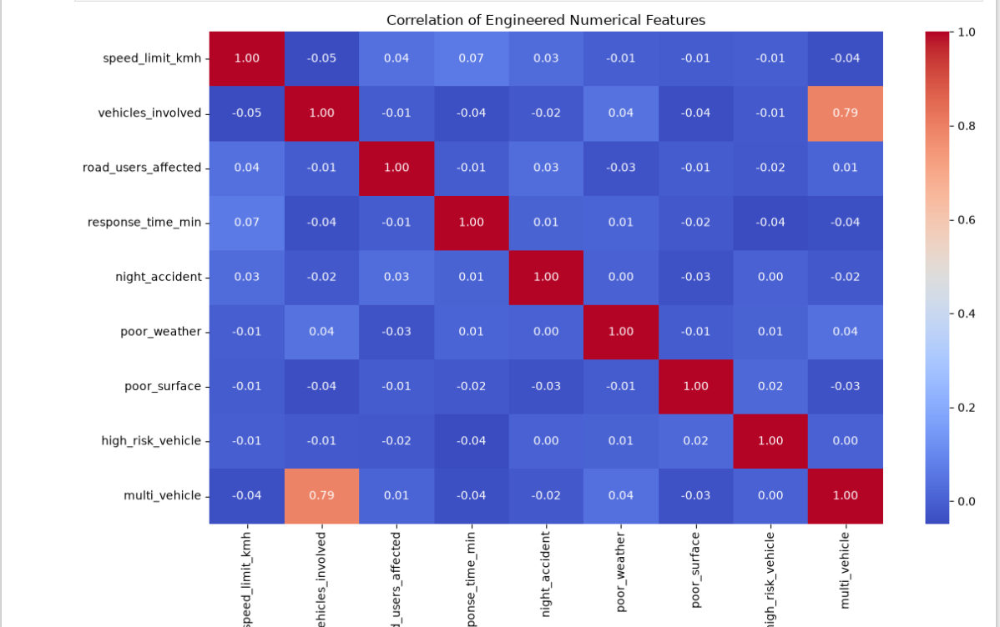

*Figure 38: Q2 feature analysis evaluates relationships and information scores.*

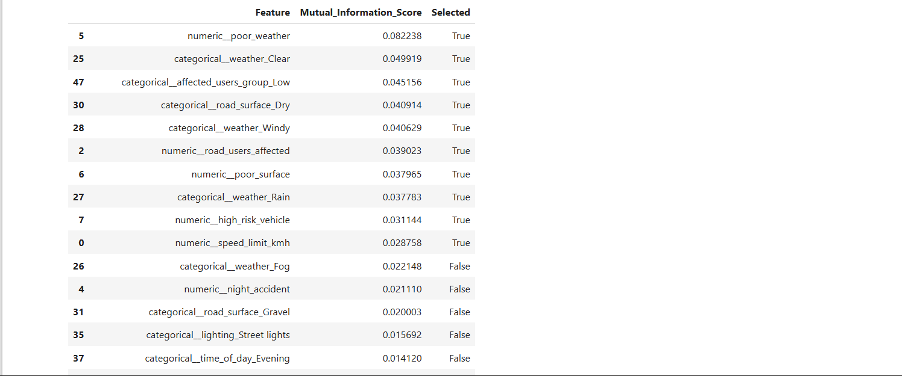

*Figure 39: The final selected Q2 feature set is displayed before export.*

### 4.6 Q2 final outputs

The full preprocessed Q2 files are saved in `q2_own_scenario/data/processed/`:

- `q2_train_final.csv`
- `q2_validation_final.csv`
- `q2_test_final.csv`

The selected-feature files are also available:

- `q2_train_selected.csv`
- `q2_validation_selected.csv`
- `q2_test_selected.csv`

The Q2 data card, scenario proposal, data dictionary, source log, data quality report, feature justification, and feature-selection scores are stored in `q2_own_scenario/docs/`.

## 5. Finalisation and Reproducibility

The finalisation evidence checks that the processed files were saved and that their schemas can be inspected after preparation. The intended reproducible workflow is:

1. Create the conda environment from `environment.yml`.
2. Start Jupyter in the repository root.
3. Run each question's notebooks in order, beginning with acquisition.
4. Keep raw files unchanged and write generated outputs to `data/interim/` and `data/processed/`.
5. Compare the resulting files and shapes with the documented outputs in this report.

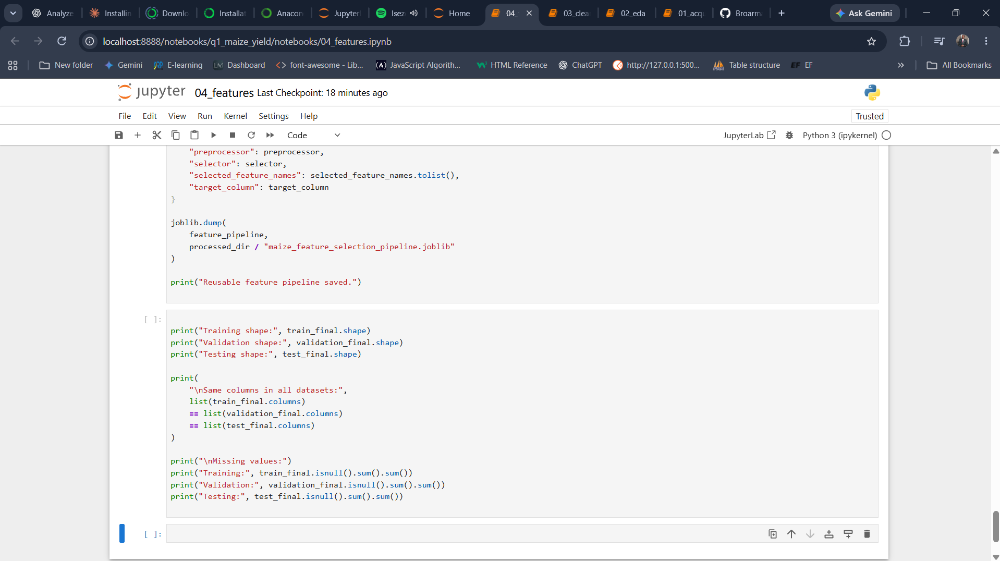

*Figure 40: Finalisation evidence shows a notebook restart and run-all check.*

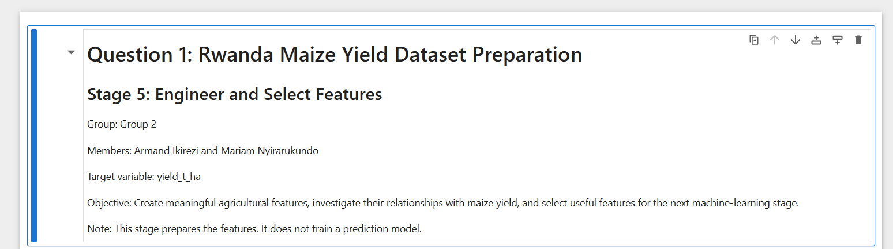

*Figure 41: The second finalisation screenshot provides additional evidence of end-to-end execution.*

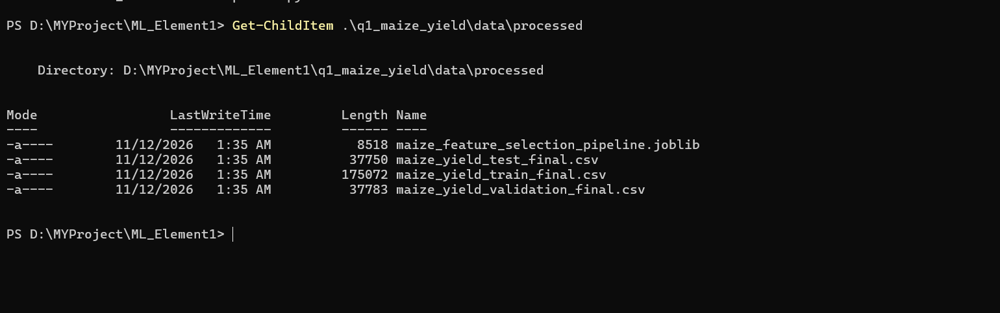

*Figure 42: The final CSV files and pipeline artifacts are saved in the project folders.*

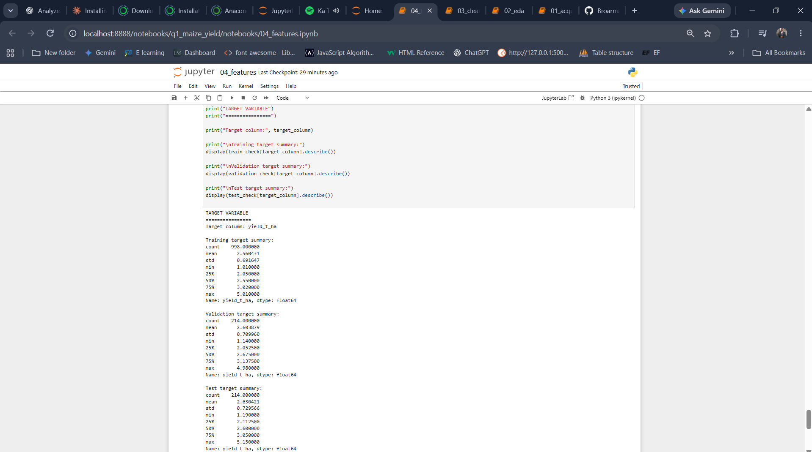

*Figure 43: Final dataset information confirms the exported file structure and dimensions.*

## 6. Limitations, Risks, and Required Follow-up

### Question 1

- The supplied Q1 schema differs from the illustrative task schema. The target is `yield_t_ha`, not `yield_kg_per_ha`, and the available variables should be confirmed before operational use.
- The dataset is synthetic and course-supplied, so its values should not be interpreted as official Rwanda agricultural statistics.
- IQR flags were retained after investigation. Domain experts should confirm whether the flagged values are genuine observations or data-entry errors.
- The two live Q1 notebooks contain recorded `SyntaxError` outputs caused by explanatory text being placed in a Python cell. These cells should be converted to Markdown or commented before the final presentation, and both Q1 notebooks should be restarted and run from top to bottom again.

### Question 2

- All accident records and severity labels are simulated and must not be used for operational road-safety decisions.
- The synthetic generator may not capture real reporting bias, district coverage, weather patterns, or accident mechanisms.
- Outlier treatment was conservative; domain review would be required for real traffic data.
- The proposed CC0-style release should be confirmed by the group and recorded consistently in the final repository.

## 7. Submission Checklist

- [x] Environment and library verification screenshots.
- [x] Repository and project-structure screenshots.
- [x] Q2 scenario proposal.
- [x] Acquisition evidence, data dictionaries, and source logs.
- [x] EDA evidence for missingness, duplicates, categories, outliers, charts, and relationships.
- [x] Cleaning logs and reusable preprocessing pipeline artifacts.
- [x] At least five engineered features for each question.
- [x] Feature selection evidence and final feature lists.
- [x] Final train, validation, and test datasets for Q1 and Q2.
- [ ] Correct the two Q1 notebook syntax errors and capture a clean final run-all screenshot.
- [ ] Complete the signed contribution log and checkpoint sign-off sheet.
- [ ] Add the final repository URL and both students' commits to the submission copy.

## Appendix A: Main Supporting Files

- [Q1 data dictionary](q1_maize_yield/docs/data_dictionary.csv)
- [Q1 source log](q1_maize_yield/docs/source_log.csv)
- [Q1 data quality report](q1_maize_yield/docs/data_quality_report.csv)
- [Q1 cleaning log](q1_maize_yield/docs/cleaning_log.csv)
- [Q1 feature justification](q1_maize_yield/docs/feature_justification.csv)
- [Q2 scenario proposal](q2_own_scenario/docs/scenario_proposal.md)
- [Q2 data card](q2_own_scenario/docs/data_card.md)
- [Q2 data dictionary](q2_own_scenario/docs/data_dictionary.csv)
- [Q2 source log](q2_own_scenario/docs/source_log.csv)
- [Q2 data quality report](q2_own_scenario/docs/data_quality_report.csv)
- [Q2 feature justification](q2_own_scenario/docs/feature_justification.csv)
- [Q2 feature selection scores](q2_own_scenario/docs/feature_selection_scores.csv)

## Appendix B: Contribution Log Template

| Stage | Driver | Navigator | Student 1 contribution | Student 2 contribution |
|---|---|---|---|---|
| 1 | To complete | To complete | To complete | To complete |
| 2 | To complete | To complete | To complete | To complete |
| 3 | To complete | To complete | To complete | To complete |
| 4 | To complete | To complete | To complete | To complete |
| 5 | To complete | To complete | To complete | To complete |
| 6 | To complete | To complete | To complete | To complete |

Student 1 signature: ____________________  
Student 2 signature: ____________________
